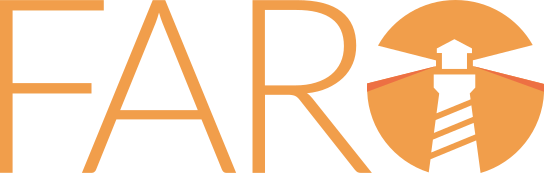

<p align="center">
  
</p>

<p align="center"><strong>Free, open-source, self-hosted screen accountability.</strong></p>

Faro is an accountability tool, not a surveillance tool. A person chooses to install it on their own computer and invites people they trust (their **allies**). Faro detects explicit content **on the device** and sends allies an **end-to-end-encrypted** report: a summary, a timeline and heavily blurred thumbnails. Allies are also told when monitoring stops or is tampered with.

There is no central Faro service. A church, a college, a small group or one person runs their own **Faro instance**, and the instance operator can't see anyone's reports.

> **Status: pre-alpha.** The protocol, cryptography and core crates are under active construction. Nothing here is ready to install yet.

## How it's private by construction

- **No unblurred image is ever stored, by anyone,** including the member's own device. Frames exist only in memory long enough to classify and blur, and are then zeroized.
- **The instance is an encrypted mailbox.** It stores ciphertext plus the minimal metadata it needs for routing, liveness and notification timing. It never runs ML or decrypts anything.
- **Members control the keys.** Devices only encrypt to ally keys signed by the member, so neither the operator nor an attacker who breaks into the server can add an eavesdropper.
- **Tamper-evident, not tamper-proof.** Every event is signed and hash-chained. Allies find out when monitoring stops, gets tampered with, or has events removed.
- **Updates are signed by the project,** not the instance, so a compromised instance can't push code to clients.

## Documentation

- [Architecture](docs/ARCHITECTURE.md): the full design, threat model and roadmap.
- [Wire protocol](docs/PROTOCOL.md): byte-level signing, hashing and encryption formats.
- [Development](docs/DEVELOPMENT.md): building, testing, crate map and the invariants every change must keep.

## Repository layout

```
crates/   Rust client crates (proto, crypto, core, detect, ipc, platform, update, service, agent)
server/   faro-server, the self-hosted instance
docs/     architecture, protocol and development docs
assets/   brand assets (logo, colours)
```

## License

Copyright © 2026 Isaiah Zimmerman.

Faro is free software under the [GNU Affero General Public License, version 3 or later](LICENSE) (AGPL-3.0-or-later). You may use, study, modify and share it. If you distribute a modified version, or run one that people use over a network (a modified `faro-server`, for example), you must offer those people its source under the same licence. Running an unmodified Faro instance asks nothing extra of you.

Contributions are accepted under the [Contributor License Agreement](CLA.md). Contributors keep their copyright and grant the maintainer a licence that also allows distributing Faro under other terms (for example an app-store build or a commercial edition). In return, the CLA promises that every contribution stays publicly available under the AGPL or another open-source licence. See [CONTRIBUTING.md](CONTRIBUTING.md).

The "Faro" name and logo are not covered by the licence and are reserved for official, project-signed builds (see ARCHITECTURE.md §11 and [assets/brand](assets/brand/README.md)). Forks are welcome under their own name.
